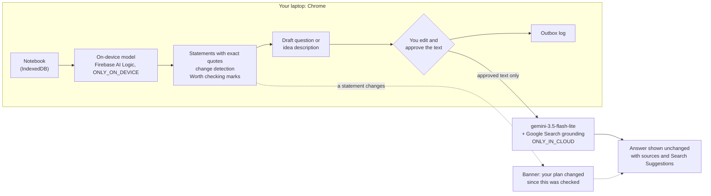

# ThoughtPartner

**An independent second opinion on your plan.**

ThoughtPartner gives your plan an independent second opinion while you write: what is worth checking, who has already built something similar, what is different about yours, and what you could combine it with, backed by web sources. You decide what leaves your laptop, and it tells you when an answer no longer fits your plan.

It is for solo builders (indie hackers, hackathon entrants, solo founders) who plan a product before they write code and have nobody to ask the question they didn't think of. A model in Chrome reads the plan on your device. A cloud model with Google Search researches only the text you approve.

> **Status:** a prototype built for #BuildHybridAI 2026 (Web/Chrome). The live demo runs app commit `4c0a907`, deployed 26 Nov 2026. All on-device results were measured on one laptop with Gemma 4 (Google updated the Gemma 4 component on 24 Nov; one run used the new version). On a real, structured plan, the on-device step first missed all four known risky assumptions. After the fixes, four reruns on the same plan extracted 4, 3, 3 and 4 of the 4 and marked 2, 1, 1 and 3 of them, with a lot of noise. I designed the fixes after seeing that plan, so this is not held-out evidence. See [Results and limits](#results-and-limits).

- **Live demo:** https://buildhybridai-2026-2c9f2.web.app (desktop Chrome)
- **Demo video:** https://youtu.be/Bj3ygLC3UMY

## Try it

1. **Use desktop Chrome** on a computer that meets Chrome's requirements for built-in AI. At the time of writing these were about 22 GB free disk space on the drive that holds your Chrome profile, and either a GPU with more than 4 GB of VRAM or at least 16 GB of RAM and 4 CPU cores.
2. **Recommended: turn on Gemma 4.** All my measurements used this setup. It is not Chrome's default.
   1. Open `chrome://flags/#gemma4-for-built-in-ai`, set it to **Enabled** and restart Chrome.
   2. Open `chrome://on-device-internals`. If Chrome blocks it, first enable internal debugging pages at `chrome://chrome-urls`. Under **Broker State**, enable the `prompt_api_gemma4` use case and wait until the Gemma 4 model has downloaded. On my laptop, Chrome wanted about 20 GB of free disk space before it would install it.
   3. Optional, as in my measured runs: untick the default `prompt_api` use case (Nano v3), so that Gemma 4 serves the Prompt API. Chrome does not report which model answered a request.
3. **Open the demo.** If the Welcome screen asks, press **Download model** or **Set up model**. The first download can take a while. Then press **Try a sample plan** (an invented restaurant-booking plan; **Remove sample** removes it and hides its statements), or **Start blank** and write or paste your own plan. Separate paragraphs with a blank line. Markdown headings, tables and lists are read by their structure.
4. **Pause for a few seconds.** Under **What your plan relies on**, statements appear with an exact quote from your text, grouped under a label that shows the section and the paragraph's first words. Some carry a quiet **Worth checking** mark, and up to three appear under **Worth checking first**, below **Research this idea**. Once all marks are in, Chrome's model picks the three most worth checking with a web search ("Chosen on this device"). Each paragraph is marked as soon as it is read: on a 1,333-word plan, the first mark appeared about 18 seconds after pasting, and the whole plan took about 6 minutes. The status line says what is happening, for example how many paragraphs are queued.
5. **Ask for a second opinion.** Press **Check this** on any statement, or **Research this idea** for the whole plan. ThoughtPartner drafts a question or a short public description on your device. Edit it if you like, then press **Send this question** / **Send this description**, or **Don't send**. The first time you send, a dialog asks for consent to research.
6. **Change your plan.** Edit or delete a statement that an answer depended on. A banner appears above the answer: "Your plan changed since this was checked."

**Chrome's default model.** Without the flag, Chrome may serve its default Gemini Nano v3. Firebase said (12 Nov 2026, relayed by Devpost staff) that Nano v3 is acceptable when it is accessed through the Firebase AI Logic SDK, and that is the only way ThoughtPartner calls the on-device model. I have not measured ThoughtPartner's quality on Nano v3.

**No on-device model?** The app says so and offers **Set up Gemma 4 in Chrome** or **Use cloud mode instead**. Cloud mode is opt-in. A dialog explains exactly what it sends, the status bar shows "Cloud mode" the whole time, and you can switch it off in **Profile**. The app never moves to the cloud on its own. Research still needs your approval for each text.

Research is limited to 20 sends per browser per day.

## How it works



| Step | Runs where | Notes |
|---|---|---|
| Read each settled paragraph into statements (assumptions, decisions, constraints, open questions), each with an exact quote. A heading gets no model call and labels the text under it. Tables and lists are read row by row, with the table header or the list's intro as context | On-device (`extract.v2`), in plan order | Code drops any statement whose quote is not in the paragraph. A quote may match after markdown emphasis and code markers are removed, but the stored quote is still an exact substring of the plan. This matching covers a conservative subset of markdown and fails closed. Each on-device call has a 180-second deadline |
| Notice a changed or removed statement | App code; on-device (`compare.v1`) only when a stored quote has disappeared | Code keeps the history of each statement and decides what is out of date |
| Quiet **Worth checking** marks | On-device (`angles.v2.1`), then app code | Code ranks the candidates with your local profile: relevance first, then topics your profile shows you know less about. No model sees the profile. Its effect is not measured on this version (see [Results and limits](#profile-effect-not-measured-on-this-version)) |
| Pick three for **Worth checking first** | On-device (`pick.v1`), once reading and marking are complete | Chooses up to 3 of the existing marks that are most worth checking with a web search. Code validates the answer and falls back to plan order. Not stored. Never blocks other work: while it runs nothing else starts, and queued work keeps its place. In cloud mode the shortlist keeps plan order |
| Draft a question (**Check this**) or a public idea description (**Research this idea**) | On-device (`question.v2.1`, `describe.v2`) | You can edit the draft. It is checked against your Never-send list and for names from your plan |
| Research | Cloud: `gemini-3.5-flash-lite` with Google Search grounding | Runs only after you approve the exact text. Idea research uses thinking level HIGH and returns similar work, what looks different, and what could be worth combining |
| Show the answer | Browser | Shown unchanged with its sources and Google Search Suggestions. Not stored, and no model reads or rates it. An idea answer without web sources is withheld |
| Mark an answer out of date | App code | When a statement it depends on changes or is removed. Adding new statements does not expire an idea answer |

In cloud mode (opt-in), the on-device steps above run on `gemini-3.5-flash-lite` instead, with the same prompts, and each paragraph is read in one request.

**How the code uses Firebase AI Logic.** Every model call goes through the Firebase JS SDK (`firebase/ai`, firebase 13.3.0):

- [`src/ai/firebase.ts`](src/ai/firebase.ts) calls `getAI(app, { backend: new GoogleAIBackend(), useLimitedUseAppCheckTokens: true })`. Every on-device step then calls `getGenerativeModel(ai, { mode: InferenceMode.ONLY_ON_DEVICE, onDeviceParams: { createOptions: { initialPrompts }, promptOptions: { responseConstraint } } })`, so the instructions and examples go in as initial prompts and the output is held to a JSON schema.
- [`src/ai/cloudResearch.ts`](src/ai/cloudResearch.ts) uses `InferenceMode.ONLY_IN_CLOUD` with `tools: [{ googleSearch: {} }]`, plus `thinkingLevel: HIGH` for idea research.
- [`src/ai/cloudProcessing.ts`](src/ai/cloudProcessing.ts) is the opt-in cloud mode (`ONLY_IN_CLOUD`, same prompts and schemas).
- **Guards.** The app checks that Chrome's Prompt API exists before it creates the on-device model and again just before each call. It discards any on-device result whose `inferenceSource` is not `on_device`, and any cloud result that is not `in_cloud`. Reason: the SDK source shows that an `ONLY_ON_DEVICE` request can be routed to the cloud when the Prompt API is missing. This comes from reading the code and was not reproduced at runtime.
- **Firebase App Check** is set up before AI Logic: reCAPTCHA Enterprise in production, and a debug provider in local development builds only. App Check enforcement for Firebase AI Logic is on for the live project.
- **Firebase Remote Config** holds four non-private settings ([`src/settings/`](src/settings/)). Remote values can switch cloud features off, lower the daily budget, or pick one of the two bundled extraction prompts. They cannot change on-device mode, the guards, the source checks, approval or App Check.
- **Firebase Hosting** serves the production build.

**Other parts.**

- Your notebook, its versions, the statements, your profile, the Never-send list and the Outbox log live in this browser's IndexedDB. ThoughtPartner has no backend of its own and no accounts.
- **Profile** (skills, past projects, lessons) is local and optional. It is an input to how code ranks the marks. When you open a marked statement, the card shows the profile records the ranking used, word for word, under "From your profile". No model writes anything about you, and **Research this idea** does not use the profile.
- **Reading status.** The status line says what is happening: reading, how many paragraphs are queued, paused while the tab is hidden, waiting for the model, or looking for things worth checking. If the on-device model doesn't answer within 180 seconds, the app shows "The on-device model stopped responding. Reload this page to continue reading." and starts no more on-device work until you reload. It does not fall back to the cloud. A part the local model can't process gets a neutral notice ("The on-device model couldn't process this part."). If browser storage is full, automatic work pauses. If the model needs preparing again, the app shows how many paragraphs are waiting and a **Prepare again** button.
- **Never send** is your list of exact terms. Adding a term withdraws any waiting or approved text that contains it.
- **Outbox** ("What left your laptop") lists every text you approved, with its time and status.
- The app works only while its tab is in front. It pauses when the tab is hidden.

## What leaves your laptop

**In on-device mode (the default):**

- Chrome's on-device model processes your plan. Nothing from your plan is sent until you approve a specific text. If the on-device model fails or stops responding, the app does not switch to the cloud.
- When you press **Send**, that exact text (a question or an idea description) goes to Google's Gemini API through Firebase AI Logic, with Google Search, together with ThoughtPartner's fixed instruction. Each sent text is logged in the Outbox. I checked the request body once in Chrome DevTools: it contained only the approved text, the instruction and the Search tool.
- Before it leaves, the text is checked for terms on your Never-send list, currency amounts, email addresses and URLs. The app also warns you if the text contains a capitalised name that also appears in your plan. These are simple checks, not a complete detector of private details, so read the text before you send it.
- Your profile and your Never-send list are not part of any request.
- Some requests carry no plan text: App Check and reCAPTCHA Enterprise verify the app, and Firebase Installations and Remote Config load settings. These send a pseudonymous installation ID, app identifiers and the browser language. Chrome may also download the model from Google. As with any web request, Google sees your IP address.
- Answers stay in page memory. They are not saved: after a reload, press **Research again**.

**In cloud mode (opt-in):** each paragraph you write, the earlier wording of a statement when the app checks what changed, and the statements and concerns derived from them go to the Gemini API so that the reading steps can run there. Your profile and Never-send list are still not sent, and research still needs your approval for each text.

## Run it yourself

### Prerequisites

- Node.js 24.12.0 or newer, and npm 11.
- Desktop Chrome with the built-in Prompt API (see [Try it](#try-it)).
- Your own Firebase project. Without one, the notebook still runs, but every AI feature stays off and the app shows "Firebase is not configured".
- For research with Google Search, billing on the Gemini Developer API. Grounding with Google Search was not available on the free tier when I checked in November 2026. The on-device features don't need billing.

### 1. Install

```sh
git clone <this-repository-url>
cd <repository-folder>
npm ci
```

### 2. Set up the Firebase project

1. Create a Firebase project and add a **Web app**. Keep its config values for step 3.
2. **Firebase AI Logic:** open AI Logic in the Firebase console and get started with the **Gemini Developer API**. For research, turn on billing. I used a small prepaid amount with a spend cap. Setting a daily API quota is also a good idea.
3. **App Check:** create a reCAPTCHA Enterprise key for the domains you will serve from (for example your Hosting domain), and register the Web app with the reCAPTCHA Enterprise provider. Once a test request succeeds, open App Check → APIs → Firebase AI Logic and **enforce** it. Enforcement can take up to 15 minutes to start.
4. **Remote Config (optional):** the app works with no parameters defined. If you add them, use these names. A value outside the accepted range is ignored and the built-in default is used.

   | Parameter | Built-in default | Accepted values |
   |---|---|---|
   | `cloud_enabled` | `true` | `true` or `false` (`false` turns off research and cloud mode) |
   | `cloud_model` | `gemini-3.5-flash-lite` | `gemini-3.5-flash-lite` only |
   | `prompt_set` | `v2` | `v1` or `v2` (bundled extraction prompts) |
   | `daily_cloud_budget` | `20` | a whole number from 0 to 20 |

   The app fetches once at startup (8-second SDK timeout, 1-hour minimum interval) and falls back to the defaults if the fetch fails.

### 3. Environment variables

Copy `.env.example` to `.env.local` (git-ignored) and fill in:

| Variable | Value |
|---|---|
| `VITE_FIREBASE_API_KEY` | `<your-web-api-key>` |
| `VITE_FIREBASE_AUTH_DOMAIN` | `<your-firebase-project-id>.firebaseapp.com` |
| `VITE_FIREBASE_PROJECT_ID` | `<your-firebase-project-id>` |
| `VITE_FIREBASE_APP_ID` | `<your-web-app-id>` |
| `VITE_RECAPTCHA_ENTERPRISE_SITE_KEY` | `<your-recaptcha-enterprise-site-key>` (required except in local debug mode) |
| `VITE_APPCHECK_DEBUG` | `false`. Set it to `true` only for local development with a debug token (step 4) |

These are browser-visible config values, not secrets, but don't commit your real values. The app treats the placeholder values from `.env.example` as "not configured".

### 4. Run locally, with an App Check debug token

```sh
npm run dev
```

This serves the app at http://127.0.0.1:5173. To use the AI features on localhost:

1. Set `VITE_APPCHECK_DEBUG=true` in `.env.local` and restart `npm run dev`.
2. Open the app in Chrome. The Firebase SDK prints an App Check debug token in the browser console.
3. In the Firebase console, open App Check → Apps → your Web app → **Manage debug tokens** and add the token.
4. Keep the token and the console output private, and delete the token when you no longer need it.

The debug provider is compiled into development builds only. `npm run check:dist` fails if a production build contains debug or evaluation code.

### 5. Test, build and deploy

| Command | What it does |
|---|---|
| `npm test` | Vitest tests. They use fakes and never call a real model |
| `npm run typecheck` | TypeScript check (`tsc --noEmit`) |
| `npm run build` | Production build into `dist/` |
| `npm run check:dist` | Checks that `dist/` contains no debug or evaluation code |
| `npm run build:prod` | Typecheck, tests, build and `check:dist` in one go |
| `npm run deploy:hosting` | Deploys `dist/` to Firebase Hosting with the pinned `firebase-tools@15.37.0`, to the project in `VITE_FIREBASE_PROJECT_ID`. Log in first with `npx firebase-tools@15.37.0 login` |

Development builds also have `/eval` (the evaluation harness used for the results below; see [`eval/RUNBOOK.md`](eval/RUNBOOK.md)) and `/dev` (a scripted-session player). Neither is in production builds.

## Results and limits

**Setup for every on-device number:** one Windows 11 laptop (4-core laptop CPU, 16 GB RAM, 4 GB GPU) running Chrome (version 157 recorded for Gate 1 and Run 2), with **Gemma 4** turned on through the flag and Nano v3 deselected. Chrome cannot confirm which model answered, so the model is self-reported from `chrome://on-device-internals`. Nothing below was measured on Nano v3 or on other hardware. Google updated the Gemma 4 component on 24 Nov (2026.8.7.929 → 2026.11.3.1140); only the 25 Nov Run 5 rerun used the new version. The pass marks (for Run 5, the counting rules) were fixed before each run.

### Gate 1: reading statements (12 Nov 2026), PASS by narrow margins

`extract.v2` on 20 invented planning paragraphs (81–172 words) × 3 repetitions = 60 calls, scored automatically against labels that were written and frozen before the run. An AI coding assistant drafted the labels and an AI reviewer audited them.

| Measure | Result | Pass mark |
|---|---|---|
| Schema-valid responses | 60/60 | ≥ 95% |
| Quotes exactly in the text | 143/147 (97.3%) | ≥ 80% |
| Recall (labelled statements found) | 94/153 (61.4%) | ≥ 60% |
| Precision (found statements that match a label) | 94/141 (66.7%) | ≥ 60% |
| Topic agreement | 75/94 (79.8%) | ≥ 70% |
| Restraint (empty brainstorm notes left empty) | 7/9 | ≥ 6/9 |
| Warm latency, ~200-word paragraph, 20 calls | median 5.6 s, p95 6.7 s | median ≤ 6 s, p95 ≤ 12 s |
| Answered on-device | 105/105 + first call | 100% |

**Limits:** the first prompt, `extract.v1`, failed this gate earlier the same day on restraint (3/9): it kept inventing open questions from brainstorm notes. `extract.v2` was written after I saw that failure on the same scored notes, so this is **not held-out evidence**. Recall and latency pass narrowly. The notes are short and invented.

### Run 2: change detection (13 Nov 2026), PASS

6 change pairs × 3 repetitions: real changes flagged 9/9, unrelated or reworded edits wrongly flagged 0/9, new wording found 9/9. **Limits:** a small set, and it had no deletion pair. A deletion case found in manual testing is now handled in code.

### Choosing what is worth checking: no verdict

The gate for the **Worth checking** marks and drafted questions ended without a verdict. I am the target user, and I could not judge the technical concerns as an expert, so the human rating was stopped and the gate was retired (17 Nov). The quality of the marks is **not established**.

### Run 4: cloud research (21 Nov 2026), PASS

10 single calls to `gemini-3.5-flash-lite` with Search grounding, from the app's development build, with App Check enforced (every call returned 200): 6 fact questions (`research.v2`) and 4 idea descriptions (`research.idea.v1`, thinking HIGH).

| Measure | Result | Pass mark |
|---|---|---|
| Results with at least one source | 10/10 | ≥ 9 |
| Search Suggestions displayed where returned | 10/10 | all |
| Fact answers that answer the question | yes 6, no 0 | yes ≥ 4, no ≤ 1 |
| Fact answers with a specific, dated fact | 6/6 | ≥ 4 |
| Idea answers whose similar work was useful | 4/4 | ≥ 3 |
| Fact latency, median | 2.7 s | ≤ 10 s |

Idea latency (reported, no pass mark): median 9.4 s with thinking HIGH.

**Limits:** n = 10, one call each. The items were written by me with my AI assistants and were not held out from prompt design. There was one rater (me), who gave the ratings in chat after reading the displayed results. No model read, rated or stored the answers. The dated-fact row mostly shows the "as of <month year>" stamp that the prompt asks for, not that each answer cites a dated source.

### Run 5: a real plan (21 and 23 Nov 2026), before and after three fixes

I pasted this project's own earliest plan (written 9 Nov; sections 1–9, 1,333 words of markdown with headings, tables and lists) into the live app, in on-device mode with Gemma 4 and an empty profile. The answer key was four assumptions in it that research later showed to be wrong. For example, it assumed that Search grounding was available on the free tier. A bet counts as extracted when a statement's quote contains it. Counts only, with no pass mark.

| | 21 Nov, before the fixes | 23 Nov, `740e0c4`, run 1 | 23 Nov, `740e0c4`, run 2 | 25 Nov, `51ea5ff`, run 3 (new Gemma 4) | 26 Nov, `7526ea1`, run 4 (video) |
|---|---|---|---|---|---|
| Bets extracted | 0/4 | 4/4 | 3/4 | 3/4 | 4/4 |
| Bets marked **Worth checking** | 0/4 | 2/4 | 1/4 | 1/4 | 3/4 |
| Statements | about 24 | 68, in 14 groups | 67 | 57 | 55 |
| **Worth checking** marks | about 13 | 17 | 15 | 17 | 16 |
| First mark after pasting | not timed | after all reading | about 6 min | about 18 s | about 31 s |
| Time until reading finished | not timed | 5 min 10 s | about 5 min 50 s | about 6 min | about 6 min, plus one stall and a reload |

**21 Nov, before the fixes.**

- A first attempt, by mistake on the local development build, extracted 1/4 and marked 0/4.
- **Supplementary, not counted:** I pressed **Check this** on a near-miss statement about verifying free-tier limits. I judged that the grounded answer described what the free tier allows.
- **Research this idea:** the on-device description was off target. I judged that it did "not look like an app description" and was "a critique of a feature". I still rated the similar work and the combinations in the grounded answer as useful.
- **Why (from the code and data):** headings counted as paragraphs, so the description had no real opening and the "Paragraph N" labels meant nothing. Long tables and lists produced a few descriptive statements instead of the bets. Gate 1 had used short prose notes only. After **Remove sample**, the sample's old statements stayed listed.

**The fixes.**

- **T15, read plans by structure.** Headings attach to their text. Labels show the section and the first words. On-device, tables and lists are read row by row, with the header or intro as context. **Remove sample** hides its statements.
- A T15-only live check on the evening of 21 Nov found reading stalled: 7 of 15 paragraphs were never read and no "worth checking" step ran. That led to T17.
- **T16, formatting-aware exact quotes.** A quote matches the plan after markdown emphasis and code markers are removed, and the stored quote is still an exact substring of the plan. The matching covers a conservative subset of markdown and fails closed. Labels are cleaned of markdown.
- **T17, reading never stalls silently.** A 180-second deadline per on-device call. A stuck model latches a "reload this page" notice, with no cloud fallback. A neutral notice when the local model can't process a part. "Browser storage is full." pauses work. **Prepare again** with a waiting count. Truthful status lines. On-device reading in plan order.

**After the fixes (four runs).** In run 1 (my main Chrome profile), reading finished in 5 min 10 s, with 68 statements in 14 groups and 17 **Worth checking** marks. All four bets were extracted and two were marked. Run 2 was a rehearsal recording for the demo video that evening, in a separate Chrome data folder whose only on-device model was Gemma 4. It found 67 statements and 15 marks, extracted three bets (not the timer) and marked one (Search grounding on the free tier). Run 3 (25 Nov, live `51ea5ff` with T18–T19, Google's updated Gemma 4, a fresh Chrome data folder) found 57 statements and 17 marks. Its first mark appeared about 18 s after pasting, and reading finished in about 6 minutes. It extracted three bets (not "Gemini Nano in Chrome") and marked one (Search grounding on the free tier). Run 4 (26 Nov, live `7526ea1`, recorded for the demo video) extracted all four bets and marked three. The on-device model stopped responding once after 12 statements; the app showed its reload notice after 180 s, and reading resumed after a reload. Details: `evidence/run5/2026-11-23-video-take1.md`, `evidence/T19/2026-11-25-live-first-mark.md` and `evidence/T20/2026-11-26-video-take2.md` in the research repository.

- **Not held-out:** I designed the fixes after seeing this plan.
- **Weak spots:** lots of noise (ticket dates as constraints, very short quotes such as "On-device"), a couple of misreadings where the quote was exact but the restatement reversed it (an item from the plan's "Out:" list was restated as something the plan includes), and some marks on minor items.
- **Research this idea** drafted this description on-device (not sent): "Solo builders lack a private second brain to plan products. This tool uses an on-device model to monitor plans, uses cloud research to propose ideas, and checks suggestions against existing plans, providing tailored advice." No verdict on it is recorded.

**Limits:** one person, my own plan, answers known in advance, fixes designed after seeing this plan, four bets, Gemma 4 only, an empty profile, and four runs after the fixes (on-device output varies between runs: 4/4, 3/4, 3/4 and 4/4 extracted), with a Gemma 4 version change before run 3. The counts come from the page text. No model rated anything.

### The shortlist pick (T20)

One run on 25 Nov (live `416a773`, the same plan, one run, not held-out: the pick instruction was written after seeing this plan). Plan order would have shown the "still fits your *current* plan" bet first. The pick chose "**Cloud** Gemini researches it with Google Search sources", "There's no backend beyond Firebase AI Logic itself" and "Search grounding not on the free tier / quota", the free-tier bet that was 14th of 17 marks. Both orders contain one bet. The pick brought up the one that changed the plan (paid tier and billing). In a second run (26 Nov, the video take), the top three in plan order held one bet (Gemini Nano in Chrome); the pick held two (Gemini Nano in Chrome, and Search grounding on the free tier). Two runs, not held-out. Details: `evidence/T20/2026-11-25-live-pick.md` and `evidence/T20/2026-11-26-video-take2.md` in the research repository.

### Profile: effect not measured on this version

The profile's effect on the **Worth checking** marks is not measured on the current version. Both real-plan runs used an empty profile. The one measurement (16 Nov, an older pipeline, two invented profiles, 17 practice notes) showed the top pick differing in 5 of 17 notes, and nobody judged whether the differences were better. **Research this idea** never uses the profile. So I don't claim profile-aware recommendations as a proven benefit.

### Other known limits

- Reading a long plan still takes minutes (marks appear while it reads) and gives many low-value statements (see Run 5).
- Chrome cannot tell the app which model answered, and quality on Chrome's default Nano v3 is untested.
- The Never-send list, the format checks and the names warning are simple checks. In a live check, one of two on-device drafts of the sample's idea description included the invented restaurant's name. That finding led to the names warning.
- The Content Security Policy is report-only, because runtime JSON-schema validation uses dynamic code.
- Open tabs don't coordinate their on-device work. Close or reload old tabs after an update.

## Prior work and disclosure

The rules ask entrants to disclose pre-existing work and to summarise what was built during the Submission Period (11 Nov 2026 22:30 CET to 30 Nov 2026 23:00 CET).

- **Sidethought (an earlier concept, by the same author).** ThoughtPartner grew out of Sidethought, an earlier "thinks alongside you" assistant for solo builders. One Sidethought build was submitted publicly to an earlier Meta hackathon (https://github.com/KostiantynBk/sidethought), and an earlier prototype was never submitted. **No Sidethought code is used here.** The concept and design lessons carried over, for example: models propose and code decides; separate "is this worth looking into?" from "is this worth saying?"; show what leaves the device.
- **Feasibility spike (9 Nov 2026, before the period).** A small throwaway diagnostics page, kept in a separate private research repository. It checked whether my laptop's Chrome exposes the on-device model and whether the Firebase AI Logic SDK returns structured JSON in each inference mode. **None of its code is in this repository.** Only lessons carried over: the local-only guard, App Check notes and SDK facts.
- **Planning written 9–11 Nov 2026 (before the period).** A product brief, a decision log, tickets and a test plan, kept in the private research repository. Copied into this repository:
  - the five v1 on-device prompt texts (`src/pipeline/prompts/*.v1.ts`);
  - two invented builder profiles (`eval/set-v1/profiles.json`, `src/profile/demoProfiles.json`);
  - three practice notes (`eval/set-v1/dev-examples.json`);
  - three scripted planning sessions (`eval/sessions-v1/`). The in-app sample plan comes from the first of them.
- **AI coding assistants.** Built with a Claude-based assistant as navigator (planning, decision records, tickets, verification and final review), a GPT-based assistant as builder (implementing the tickets) and a separate GPT-based assistant as code reviewer. I made the product decisions and gave every human rating. Every on-device and cloud test ran on my laptop.
- **Open-source libraries:** the Firebase JS SDK, React, Ajv and idb; Vite, Vitest and TypeScript for development. See `package.json`.

### What was built during the Submission Period

All code in this repository was written during the period. The first commit is from 12 Nov 2026. In order:

1. Scaffold: guarded on-device inference through Firebase AI Logic, model download and readiness, and App Check.
2. Statement extraction with the evaluation harness, plus the scored test set, labels and change pairs (Gate 1).
3. Remote Config for four non-private settings.
4. The local versioned notebook, profile and IndexedDB store.
5. Change detection, statement history and staleness (Run 2).
6. Selecting what is worth checking, drafting public questions, the Outbox and the Never-send list, with two prompt revisions.
7. Cloud research with Google Search grounding, shown unchanged, and the opt-in cloud mode.
8. Quiet marks, **Check this** on any statement, and approval on the card.
9. Firebase Hosting, production App Check with reCAPTCHA Enterprise, and enforcement.
10. **Research this idea**: an on-device description and grounded idea research with thinking HIGH. Also the design and first-run screens, idea answers without web sources withheld, and the names-from-your-plan warning.
11. Reading plans by their structure (T15): headings, section labels, tables and lists read row by row on-device, and **Remove sample** hiding its statements.
12. Formatting-aware exact quotes and cleaned labels (T16).
13. Reading that never stalls silently (T17): a deadline per on-device call, truthful status and notices, and on-device reading in plan order.
14. The flow a judge sees (T18): a **Worth checking first** shortlist, cards that open under their statement, a notebook that stays in view, an in-app consent dialog that records consent only in the same step as a send that passes its checks, and **Not private** on the names warning.
15. Marks while reading (T19): each paragraph is marked right after it is read (first mark in about 18 s on a 1,333-word plan, instead of after the whole plan), and statements whose quote has fewer than 3 words are dropped.
16. The on-device pick for **Worth checking first** (T20): after marking, Chrome's model picks the three marks most worth checking with a web search, validated by code, with a plan-order fallback, nothing stored, and no effect on other work (`7526ea1`, 25 Nov 2026).
17. Typing no longer makes the page jump (T21): while the notebook saves, the statement list and shortlist stay on screen but can't be used, instead of disappearing for a moment on every key press. The live demo runs this version (`4c0a907`, deployed 26 Nov 2026).

## Licence

[Apache License 2.0](LICENSE).

ThoughtPartner is an independent hackathon entry. It is not affiliated with or endorsed by Google, Firebase or Devpost. Product names appear only to describe the technology used.
